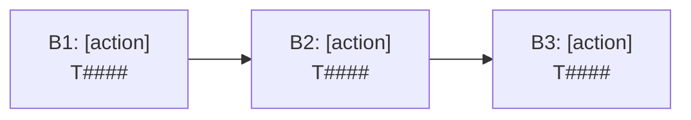

## 1. Case Information *(Step 2: Open the case)*

| Field | Value |
|---|---|
| Case ID | Case-001 |
| Incident name | Colonial Pipeline 2021 |
| Analyst | Furrell-Meas |
| Date opened | 17 Nov 2026 |
| Date closed | [YYYY-MM-DD] |
| Status | In progress |
| ATT&CK version used |  Enterprise v20.1 |
| Case type | Retrospective analysis of a public incident (open-source only) |
| Classification | TLP:CLEAR (public sources only) |

---

## 2. Executive Summary *(Step 8: write this LAST)*

*Write 4–6 sentences for a non-technical manager. Cover what happened, how the attacker got in, the most important weakness, the impact, and the single most important lesson.*

[Summary]

---

## 3. Incident Overview *(Step 2)*

| Field | Value |
|---|---|
| Victim organisation | [Name, industry, country] |
| Date(s) of incident | [Start – end, with time zone if known] |
| Date disclosed | [When the public found out] |
| Threat actor | [Name / group, or "Unknown"] |
| Attribution confidence | [High / Medium / Low, and who attributed it] |
| Motivation | [Financial, notoriety, espionage, unknown...] |
| Initial access vector (one line) | [e.g. "Phishing email with malicious attachment"] |
| Impact (one line) | [e.g. "Internal tools compromised; data downloaded"] |

**Scope statement:** *What this analysis covers and what it doesn't. Example: "This analysis covers the intrusion from initial access to containment. It does not cover the earlier malware infection of the contractor's personal device, which was done by an unknown party."*

[Scope statement]

---

## 4. Sources *(Step 1: Collect sources)*

**Source types:**
- **Primary:** the victim, a court, a regulator or a government body (Uber's own statement, an SEC filing, a CISA advisory).
- **Secondary:** journalists or security vendors reporting on the incident.
- **Claim:** a statement from the attacker. Useful, but never fully trusted.

**Reliability:** High / Medium / Low. Ask: would this source know, and does it have a reason to exaggerate?

| ID | Title | Publisher | Date | Type | Reliability | Link |
|---|---|---|---|---|---|---|
| S1 | Department of Justice Seizes $2.3 Million in Cryptocurrency Paid to the Ransomware Extortionists Darkside | US Department of Justice | 7 June 2021 | Primary | High | https://www.justice.gov/archives/opa/pr/department-justice-seizes-23-million-cryptocurrency-paid-ransomware-extortionists-darkside |
| S2 | Darkside Ransomware: Best Practices for Preventing Business Disruption from Ransomware Attacks | CISA & FBI | 11 May 2021 | Primary | High | https://www.cisa.gov/sites/default/files/publications/AA21-131A_Darkside_Ransomware.pdf |
| S3 | Hackers breached Colonial Pipeline with one compromised password | Aljazeera:Bloomberg | 4 June 2021 | Secondary | High | https://www.aljazeera.com/economy/2021/6/4/hackers-breached-colonial-pipeline-with-one-compromised-password |
| S4 | Colonial Pipeline CEO defends handling of ransomware attack in Senate testimony | CBSnews | 8 June 2021 | Secondary | High | https://www.cbsnews.com/news/colonial-pipeline-ceo-ransomware-hackers-senate-hearing/ |
| S5 | Shining a Light on DARKSIDE Ransomware Operations | Mandiant | 11 May 2021 | Secondary | High | https://cloud.google.com/blog/topics/threat-intelligence/shining-a-light-on-darkside-ransomware-operations |
| S6 | Colonial Pipeline Paid Hackers Nearly $5 Million in Ransom | Claims Journal:Bloomberg | 14 May 2021 | Secondary | High | https://www.claimsjournal.com/news/national/2021/05/14/303742.htm |
| S7 | THREATS TO CRITICAL INFRASTRUCTURE:EXAMINING THE COLONIAL PIPELINE CYBERATTACK (S. Hrg. 117-429) | US Government Publishing Office | 8 June 2021 | Primary | High | https://www.govinfo.gov/content/pkg/CHRG-117shrg46569/html/CHRG-117shrg46569.htm |

---

## 5. Timeline of Events *(Step 3: Build the timeline)*

| Event | Date | Who | What happened (fact) | Source(s) | Confirmed or claimed? |
|---|---|---|---|---|---|
| E1 | 29 April 2021 | Attacker | Logged in to Colonial's network through a legacy VPN account that was no longer meant to be in use. The account used only a password (no MFA). | S3, S7 | Confirmed |
| E2 | 29 April – 7 May 2021 (exact date unknown) | Attacker | Moved around Colonial's IT network. No sign of access to the OT network. | S3 | Confirmed (investigator) |
| E3 | 29 April – 7 May 2021 (exact date unknown) | Attacker | Stole nearly 100 GB of data from a share drive, in about two hours. | S3, S7 | Confirmed |
| E4 | 07 May 2021, before ~5 a.m. | Attacker | Deployed DarkSide ransomware, encrypting Colonial's IT systems. Left a ransom note demanding cryptocurrency for a decryption key, stating that data had been encrypted and stolen, and threatening to leak the data if not paid. | S2, S3, S7 | Confirmed |
| E5 | 07 May 2021, just before 5 a.m. | Victim | A control-room employee found the ransom note and told an operations supervisor. | S3, S7 | Confirmed |
| E6 | 07 May 2021, by 6:10 a.m. | Victim | Shut down the entire pipeline and disconnected certain OT systems as a precaution. | S2, S3 | Confirmed |
| E7 | 07 May 2021, morning | Victim | Contacted the FBI. | S7 | Confirmed |
| E8 | 07 May 2021, just after noon | Victim | CISA joined a call with Colonial and the FBI. | S7 | Confirmed |
| E9 | 07 May 2021 (time unknown) | Victim | Engaged Mandiant to investigate. | S7 | Confirmed |
| E10 | 07 May 2021, evening | Victim | Decided to negotiate with the attackers. | S7 | Confirmed |
| E11 | 08 May 2021 | Victim | Paid a ransom of about 75 bitcoin (~US$4.4M). | S1, S7 | Confirmed |
| E12 | Unknown (after E11) | Attacker | Gave Colonial a decryption tool, which worked but was "not a perfect tool". | S4, S7 | Confirmed |
| E13 | Unknown (after E9) | Mandiant | Swept the network and installed new detection tools to catch follow-up attacks. | S3 | Confirmed (investigator) |
| E14 | 12 May 2021, ~5 p.m. ET | Victim | Began resuming fuel shipments. | S6, S7 | Confirmed |
| E15 | 07 June 2021 | DOJ | Seized 63.7 bitcoin (~US$2.3M) traced to the ransom payment. | S1 | Confirmed |
| E16 | 08 June 2021 | Victim | CEO testified to the US Senate about the attack. | S4, S7 | Confirmed |

**Investigation findings (undated):**
- Mandiant found no evidence that the attackers reached the OT network. The attack was detected only in IT. (S2, S7)
- Mandiant saw no attacker activity before 29 April and no evidence of phishing. (S3)

**Intelligence gaps:**
- How the attackers obtained the VPN password is unknown. It was later found in a batch of leaked passwords on the dark web, but Mandiant could not confirm this was the source. (S3, S7)
- The exact dates of E2 and E3 are not public.
- The exact time the decryption tool was received (E12) is not public.

---

## 6. Behaviour Extraction *(Step 4: Break events into behaviours)*

| Behaviour | From event | Attacker action | Evidence (paraphrase + source) |
|---|---|---|---|
| B1 | E1 | Logged in to Colonial's VPN using the valid password of an unused legacy account. | Mandiant: entry via an unused VPN account on 29 April (S3). CEO: legacy VPN profile with single-factor authentication only (S7). |
| B2 | E2 | Moved around Colonial's IT network (but not into OT). | Mandiant: attackers moved within the IT network, with no sign of OT access (S3). |
| B3 | E3 | Collected data from a shared drive on the IT network. | CEO: the data was exfiltrated off the share drive (S7). |
| B4 | E3 | Stole (exfiltrated) about 100 GB of data in about two hours. | Senator Peters: ~100 GB in two hours (S7). Bloomberg: ~100 GB stolen (S3). CEO confirmed the exfiltration (S7). |
| B5 | E4 | Deployed DarkSide ransomware, encrypting Colonial's IT systems. | CISA/FBI: ransomware deployed against the IT network (S2). CEO: the attack encrypted IT systems (S7). |
| B6 | E4 | Left a ransom note demanding cryptocurrency for a decryption key, stating that data had been encrypted and stolen. | Employee found a note demanding cryptocurrency (S3). CEO: payment demanded for a key; note said data was encrypted and exfiltrated (S7). |
| B7 | E4 | Threatened to leak the stolen data if the ransom was not paid. | Bloomberg: attackers threatened to leak the data (S3). CEO on the note's contents (S7). |
| B8 | E12 | Provided a decryption tool after the ransom was paid. | CEO: tool provided, helpful but not perfect (S7). DarkSide gave decryption keys after payment (S4). |

> **Not behaviours:** E5–E11 and E13–E16 are actions by Colonial, Mandiant, the government or the DOJ. They go in Victim Response and Lessons Learned, not the mapping.
---

## 7. ATT&CK Mapping *(Step 5: Map behaviours to ATT&CK)*

| Behaviour | Tactic | Technique ID | Technique / sub-technique name | Why this technique (justification) | Confidence | Source(s) |
|---|---|---|---|---|---|---|
| B1 | Initial Access | T1078 | Valid Accounts | The CEO's testimony (S7) and Mandiant via Bloomberg (S3) show the attacker logged in with the real password of a legitimate but unused legacy VPN account. T1078 covers adversaries using legitimate credentials to gain access. Kept at the parent technique because no source states the account type. | High | S3, S7 |
| B1 | Initial Access | T1133 | External Remote Services | The login was made through Colonial's VPN, an external-facing remote access service named in T1133's definition. T1078 describes the credentials used; T1133 the service they were used on. | High | S3, S7 |
| B3 | Collection | T1039 | Data from Network Shared Drive | The CEO testified the stolen data was taken "off the share drive" (S7). T1039 covers collecting data from network shares. Confidence limited by the single, non-technical description of the share. | Medium | S7 |
| B5 | Impact | T1486 | Data Encrypted for Impact | The CEO (S7) and CISA/FBI (S2) confirm DarkSide ransomware encrypted Colonial's IT systems. T1486 covers encrypting data to make it unavailable to the victim. | High | S2, S7 |
| B6, B7 | Impact | T1657 | Financial Theft | The ransom note demanded cryptocurrency for a decryption key and threatened to leak stolen data (S3, S7); the ransom was paid to DarkSide (S1). T1657 covers extortion, including ransomware payment demands combined with threats to leak stolen data. | High | S1, S3, S7 |

> **B2 not mapped (Lateral Movement).** Movement within the IT network is confirmed (S3, S7), but no source describes how it was done. See 7.1.
>
> **B4 tactic confirmed, technique not identified (Exfiltration).** Theft of ~100 GB is confirmed (S3, S7), but no source states the tool or protocol used. See 7.1.
>
> **B8 not mapped.** Providing a decryption tool after payment is part of the extortion covered by T1657, not a separate attack goal.

### 7.1 Considered but not mapped

*Showing what you rejected and why is one of the strongest signals of analyst maturity.*

| Candidate technique | Why it was considered | Why it was rejected |
|---|---|---|
| T#### | | |

---

## 8. Attack Flow *(Step 6: Visualise)*

*A simple diagram of the attack in order. GitHub renders Mermaid diagrams automatically.*

---

## 9. ATT&CK Navigator Layer

- Layer file: [`navigator-layer.json`](./navigator-layer.json)
- To view it, open https://mitre-attack.github.io/attack-navigator/, choose **Open Existing Layer → Upload from local**, and select the file. Hover over a technique to see its behaviour, evidence and sources.
- Layer built on ATT&CK Enterprise **v20** in Navigator; all technique IDs checked against **v20.1**.
- Techniques are coloured only under the tactic they were mapped to in Section 7 (T1078 and T1133 under Initial Access only).
- **B2 (lateral movement)** and **B4 (exfiltration)** appear in the attack flow (Section 8) but not in this layer: the tactics are confirmed but the techniques could not be identified (see 7.1).

**Colour key:** 🟥 score 3 = High confidence · 🟧 score 2 = Medium · 🟨 score 1 = Low

---

## 10. Detection Opportunities *(Step 7: Defensive analysis)*

*For each important technique: which log would show it, what you would look for, and an example of the logic. Use the "Detection" section of each technique page on attack.mitre.org.*

| Technique | Log source / data component | What to look for | Example detection logic (pseudo-query) |
|---|---|---|---|
| T1078 Valid Accounts | VPN gateway auth logs + directory (AD) account data (last logon, account status) + HR/account inventory | Successful VPN login to an account unused for 90+ days, or recorded as no longer in use, such as the legacy account used in B1 (S7) | `vpn_auth where result="success" \| join accounts on user \| where days_since(prev_logon) > 90 or hr_status="not in use" \| alert high` |
| T1039 Data from Network Shared Drive | Netflow/firewall (SMB volume) + Windows Security 5140 (account and source address per share) + 5145 (file-level detail, noisy); assumes file share auditing enabled | One source reading >20 GB from file shares within 1 hour (Colonial: ~100 GB in ~2 h, S7/S8); high severity if the account is dormant or the VPN source has never accessed that share | `netflow where dest_port=445 and server in file_servers \| sum(bytes_from_server) by client_ip over 1h \| where total > 20GB \| join event_5140 on client_ip \| join accounts on user \| severity = high if dormant or new VPN source else medium` · Tune: Measure activity regarding volume of data/hour before switching the alert on. |
| T1486 Data Encrypted for Impact | EDR file telemetry (FileWritten, FileModified, FileRenamed) + Windows Security 5145 (network share file access with write access requested); assumes detailed file share auditing is enabled | One account on one host writing to hundreds of different files within a minute while many of those files are renamed to the same new, previously unseen extension. Encryption of Colonial's IT systems on 7 May is confirmed (S2, S7); this fires during encryption, so its value is containing the spread rather than preventing the first files being encrypted | `EDR file events + Security 5145 where access in (write, modify, rename) \| count distinct file_name, count distinct new_extension by account, host over 1 minute \| where distinct_files > 300 and files_with_same_new_extension > 50 \| alert high and isolate host` · Thresholds set well above normal user activity as a starting point · ATT&CK reference: DET#### · Tune: backup agents, file-sync tools, antivirus scans and software deployments can rewrite many files quickly, so baseline each account's normal file activity, allowlist known backup/sync service accounts and servers, and require both conditions (volume + new extension) before alerting; review the allowlist regularly, since attackers may abuse excluded accounts |
---

## 11. Mitigations & Recommendations *(Step 7)*

*Use the "Mitigations" section (M#### IDs) on each technique page. Then write a concrete recommendation in your own words.*

| Technique | Mitigation ID | Recommendation | Priority |
|---|---|---|---|
| T1133 External Remote Services | M1032 Multi-factor Authentication | Require MFA on every VPN and remote-access account, including legacy and rarely used profiles, with no single-factor exceptions. Use phishing-resistant methods (FIDO2 security keys or number matching) instead of SMS codes or simple push approvals. Also reduces T1078. | High |
| T1078 Valid Accounts | M1018 User Account Management | Review all VPN and remote-access accounts every quarter. Automatically disable any account with no login in 60 days, and remove access the same day a person leaves or changes role. Assign each account a named owner, so that no account stays active without anyone using it. | High |
| T1657 Financial Theft | No direct ATT&CK mitigation | Create and rehearse a ransomware incident response plan. It should include: who decides whether to pay a ransom and on what criteria; legal, insurer and law-enforcement contacts; and a process to keep running or manually restore operations when IT systems are down. Colonial had no such guidance before the attack. | High |

--- 

## 12. Victim Response *(Step 3/7)*

*What the victim and other defenders did to detect, contain, eradicate and recover. These are not attacker behaviours, so they don't get ATT&CK IDs. Actions are grouped by the NIST SP 800-61 incident response lifecycle.*

### 12.1 Response actions

| # | IR phase | Date / time (ET) | Action taken | Who acted | Source(s) | Notes / conflicts |
|---|---|---|---|---|---|---|
| R1 | Detection & Analysis | 7 May 2021, just before 05:00 | A control-room employee found a ransom note on a computer and alerted an operations supervisor | Colonial (control room) | S3 | Detection came from the attacker's own ransom note, not from a security alert |
| R2 | Containment | 7 May 2021, ~05:00–06:10 | The supervisor started a shutdown; the entire pipeline was offline by 06:10, the first full shutdown in the company's 57-year history | Colonial (operations) | S3, S7 | **Precautionary.** Done because OT compromise couldn't be ruled out, not because OT was known to be affected |
| R3 | Containment | 7–12 May 2021 | Kept the pipeline under pressure to speed restart, checked gauges by hand, increased aerial and ground patrols (~29,000 miles driven) to rule out physical damage, and ran small sections manually | Colonial (operations) | S7 | Safety checks on the physical asset while the digital investigation ran |
| R4 | Detection & Analysis | 7 May 2021, within hours | Reported the attack to the FBI (Atlanta office, which referred Colonial to the San Francisco team that tracks DarkSide) | Colonial | S7, S4, S1 | DOJ publicly thanked Colonial for notifying the FBI quickly (S1) |
| R5 | Detection & Analysis | 7 May 2021, shortly after 12:00 | Joined a call with the FBI and CISA, which the FBI arranged | Colonial, FBI, CISA | S7 | **Disputed.** Senators questioned why Colonial didn't contact CISA directly; the CEO said it would have if the FBI hadn't (S7) |
| R6 | Detection & Analysis | From 7 May 2021 | Notified the Department of Energy, FERC, PHMSA, trade groups and other agencies; DOE acted as the central coordination point | Colonial | S7 | — |
| R7 | Detection & Analysis | 7 May 2021 onward (exact date not stated) | Engaged **Mandiant** to lead investigation and restoration, **Dragos** for OT security, and **Black Hills Information Security** to advise on defences | Colonial | S7, S4, S3 | Dragos specialises in industrial / OT security, which fits the need to rule out OT compromise |
| R8 | Detection & Analysis | 7 May 2021, evening | Hired legal counsel and ransom-negotiation experts | Colonial | S7 | — |
| R9 | Detection & Analysis | After 7 May 2021 | Shared indicators of compromise with the FBI and CISA; CISA later published attacker IP addresses for industry | Colonial, CISA | S7 | Example of information sharing benefiting other organisations |
| R10 | Detection & Analysis | By 8 Jun 2021 | Investigation found the attack concentrated in the **IT network**; Mandiant had not confirmed any OT compromise | Mandiant | S7, S3, S4 | Supports mapping to Enterprise ATT&CK only (no ICS techniques) |
| R11 | Eradication & Recovery | 7 May 2021, evening | Decided to negotiate with DarkSide | Colonial (CEO) | S7 | CEO said the decision was the company's alone; he knew the FBI's position against paying and said Colonial checked DarkSide wasn't on the OFAC sanctions list (S7) |
| R12 | Eradication & Recovery | 8 May 2021 | Paid a ransom of ~**75 BTC** (~US$4.4M) | Colonial | S1, S7 | **Conflict.** S4: ~$4.3M; S6: "nearly $5M" paid on 7 May (anonymous sources). Primary sources S1/S7 give 75 BTC on 8 May; USD figures vary with the BTC price |
| R13 | Eradication & Recovery | After 8 May 2021 | Received a decryptor from the attackers; it helped partially, and Colonial also restored from its own backups | Colonial | S6, S7, S4 | **Conflict.** S6 (anonymous, 14 May): decryptor too slow to be of much use. CEO under oath (S7): worked to some degree, not perfect |
| R14 | Eradication & Recovery | Date not stated | Deactivated the unused legacy VPN account the attackers used | Colonial | S3 | The account lacked MFA (S3, S7) |
| R15 | Eradication & Recovery | Date not stated | Mandiant swept the network and installed new detection tools to catch follow-on attacks | Mandiant | S3 | — |
| R16 | Eradication & Recovery | 12 May 2021, ~17:00 | Restarted fuel shipments after confirming the attack was contained; physical inspection found no pipeline damage | Colonial | S6, S3 | Pipeline down ~5.5 days |
| R17 | Eradication & Recovery | Through June 2021 | Continued restoring business IT systems; financial systems came back online around 8 June; CEO said full restoration could take months or years | Colonial | S4, S7 | Pipeline running ≠ fully recovered |
| R18 | Post-Incident | By 8 Jun 2021 | Rebuilt and restored critical IT systems; said it was implementing the new TSA and CISA directives and was in full compliance with the new TSA requirements | Colonial | S7 | — |
| R19 | Post-Incident | 8 Jun 2021 | CEO agreed MFA should be required going forward | Colonial (CEO) | S7 | Directly addresses the initial access weakness |
| R20 | Post-Incident | Late July 2021 (planned) | Scheduled a previously delayed voluntary TSA architecture design review (VADR) | Colonial, TSA | S7 | — |
| R21 | Post-Incident | By 8 Jun 2021 | Began evaluating the ability to operate the pipeline manually | Colonial | S7 | Resilience improvement: run without IT if needed |
| R22 | Post-Incident | 7 Jun 2021 | DOJ seized **63.7 BTC** (~US$2.3M) of the ransom by tracing payments on the public Bitcoin ledger to an address whose private key the FBI held | FBI / DOJ | S1, S7 | CEO credited Colonial's quiet, early cooperation with law enforcement (S7). Gap of ~11.3 BTC not explained (S1) |
| R23 | Post-Incident | 8 Jun 2021 | CEO testified before the US Senate | Colonial (CEO) | S7, S4 | — |

### 12.2 Key observations (carry into Section 13)

1. **Detection was late and came from the attacker.** The attackers got in on 29 April (S3); Colonial learned of it from a ransom note on 7 May. No security alert caught the intrusion or the data theft first.
2. **Containment was precautionary and costly.** The IT/OT boundary wasn't trusted enough to keep the pipeline running, so all of it was shut down.
3. **Paying didn't guarantee fast recovery.** Backups were still needed, and business systems took weeks.
4. **Reporting helped recover money.** Early FBI notification contributed to the partial recovery of the ransom.

### 12.3 Response-related intelligence gaps

- Exact date the legacy VPN account was deactivated.
- Exactly how much was restored by the decryptor versus backups.
- Whether Colonial finished reviewing the ~100 GB of data the attackers took (S7 says the review wasn't complete at the time of the hearing).
- Where the ~11.3 BTC not seized by DOJ went.
---

## 13. Analyst Notes & Lessons Learned *(Step 8)*

**Key lessons (for defenders):**
1. 

**Intelligence gaps / open questions:** *What couldn't you confirm? Where do sources disagree?*
- 

**What I learned doing this analysis:** *Employers read this section. Be honest and specific.*
- 

---

## 14. Change Log

| Date | Change |
|---|---|
| [YYYY-MM-DD] | Case opened |

