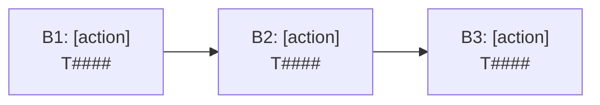

## 1. Case Information *(Step 2: Open the case)*

| Field | Value |
|---|---|
| Case ID | Case-001 |
| Incident name | Colonial Pipeline 2021 |
| Analyst | Furrell-Meas |
| Date opened | 17 Nov 2026 |
| Date closed | [YYYY-MM-DD] |
| Status | In progress |
| ATT&CK version used |  Enterprise v20.1 |
| Case type | Retrospective analysis of a public incident (open-source only) |
| Classification | TLP:CLEAR (public sources only) |

---

## 2. Executive Summary *(Step 8: write this LAST)*

*Write 4–6 sentences for a non-technical manager. Cover what happened, how the attacker got in, the most important weakness, the impact, and the single most important lesson.*

[Summary]

---

## 3. Incident Overview *(Step 2)*

| Field | Value |
|---|---|
| Victim organisation | [Name, industry, country] |
| Date(s) of incident | [Start – end, with time zone if known] |
| Date disclosed | [When the public found out] |
| Threat actor | [Name / group, or "Unknown"] |
| Attribution confidence | [High / Medium / Low, and who attributed it] |
| Motivation | [Financial, notoriety, espionage, unknown...] |
| Initial access vector (one line) | [e.g. "Phishing email with malicious attachment"] |
| Impact (one line) | [e.g. "Internal tools compromised; data downloaded"] |

**Scope statement:** *What this analysis covers and what it doesn't. Example: "This analysis covers the intrusion from initial access to containment. It does not cover the earlier malware infection of the contractor's personal device, which was done by an unknown party."*

[Scope statement]

---

## 4. Sources *(Step 1: Collect sources)*

**Source types:**
- **Primary:** the victim, a court, a regulator or a government body (Uber's own statement, an SEC filing, a CISA advisory).
- **Secondary:** journalists or security vendors reporting on the incident.
- **Claim:** a statement from the attacker. Useful, but never fully trusted.

**Reliability:** High / Medium / Low. Ask: would this source know, and does it have a reason to exaggerate?

| ID | Title | Publisher | Date | Type | Reliability | Link |
|---|---|---|---|---|---|---|
| S1 | Department of Justice Seizes $2.3 Million in Cryptocurrency Paid to the Ransomware Extortionists Darkside | US Department of Justice | 7 June 2021 | Primary | High | https://www.justice.gov/archives/opa/pr/department-justice-seizes-23-million-cryptocurrency-paid-ransomware-extortionists-darkside |
| S2 | Darkside Ransomware: Best Practices for Preventing Business Disruption from Ransomware Attacks | CISA & FBI | 11 May 2021 | Primary | High | https://www.cisa.gov/sites/default/files/publications/AA21-131A_Darkside_Ransomware.pdf |
| S3 | Hackers breached Colonial Pipeline with one compromised password | Aljazeera:Bloomberg | 4 June 2021 | Secondary | High | https://www.aljazeera.com/economy/2021/6/4/hackers-breached-colonial-pipeline-with-one-compromised-password |
| S4 | Colonial Pipeline CEO defends handling of ransomware attack in Senate testimony | CBSnews | 8 June 2021 | Secondary | High | https://www.cbsnews.com/news/colonial-pipeline-ceo-ransomware-hackers-senate-hearing/ |
| S5 | Shining a Light on DARKSIDE Ransomware Operations | Mandiant | 11 May 2021 | Secondary | High | https://cloud.google.com/blog/topics/threat-intelligence/shining-a-light-on-darkside-ransomware-operations |
| S6 | Colonial Pipeline Paid Hackers Nearly $5 Million in Ransom | Claims Journal:Bloomberg | 14 May 2021 | Secondary | High | https://www.claimsjournal.com/news/national/2021/05/14/303742.htm |
| S7 | THREATS TO CRITICAL INFRASTRUCTURE:EXAMINING THE COLONIAL PIPELINE CYBERATTACK (S. Hrg. 117-429) | US Government Publishing Office | 8 June 2021 | Primary | High | https://www.govinfo.gov/content/pkg/CHRG-117shrg46569/html/CHRG-117shrg46569.htm |

---

## 5. Timeline of Events *(Step 3: Build the timeline)*

| Event | Date | Who | What happened (fact) | Source(s) | Confirmed or claimed? |
|---|---|---|---|---|---|
| E1 | 29 April 2021 | Attacker | Logged in to Colonial's network through a legacy VPN account that was no longer meant to be in use. The account used only a password (no MFA). | S3, S7 | Confirmed |
| E2 | 29 April – 7 May 2021 (exact date unknown) | Attacker | Moved around Colonial's IT network. No sign of access to the OT network. | S3 | Confirmed (investigator) |
| E3 | 29 April – 7 May 2021 (exact date unknown) | Attacker | Stole nearly 100 GB of data from a share drive, in about two hours. | S3, S7 | Confirmed |
| E4 | 07 May 2021, before ~5 a.m. | Attacker | Deployed DarkSide ransomware, encrypting Colonial's IT systems. Left a ransom note demanding cryptocurrency for a decryption key, stating that data had been encrypted and stolen, and threatening to leak the data if not paid. | S2, S3, S7 | Confirmed |
| E5 | 07 May 2021, just before 5 a.m. | Victim | A control-room employee found the ransom note and told an operations supervisor. | S3, S7 | Confirmed |
| E6 | 07 May 2021, by 6:10 a.m. | Victim | Shut down the entire pipeline and disconnected certain OT systems as a precaution. | S2, S3 | Confirmed |
| E7 | 07 May 2021, morning | Victim | Contacted the FBI. | S7 | Confirmed |
| E8 | 07 May 2021, just after noon | Victim | CISA joined a call with Colonial and the FBI. | S7 | Confirmed |
| E9 | 07 May 2021 (time unknown) | Victim | Engaged Mandiant to investigate. | S7 | Confirmed |
| E10 | 07 May 2021, evening | Victim | Decided to negotiate with the attackers. | S7 | Confirmed |
| E11 | 08 May 2021 | Victim | Paid a ransom of about 75 bitcoin (~US$4.4M). | S1, S7 | Confirmed |
| E12 | Unknown (after E11) | Attacker | Gave Colonial a decryption tool, which worked but was "not a perfect tool". | S4, S7 | Confirmed |
| E13 | Unknown (after E9) | Mandiant | Swept the network and installed new detection tools to catch follow-up attacks. | S3 | Confirmed (investigator) |
| E14 | 12 May 2021, ~5 p.m. ET | Victim | Began resuming fuel shipments. | S6, S7 | Confirmed |
| E15 | 07 June 2021 | DOJ | Seized 63.7 bitcoin (~US$2.3M) traced to the ransom payment. | S1 | Confirmed |
| E16 | 08 June 2021 | Victim | CEO testified to the US Senate about the attack. | S4, S7 | Confirmed |

**Investigation findings (undated):**
- Mandiant found no evidence that the attackers reached the OT network. The attack was detected only in IT. (S2, S7)
- Mandiant saw no attacker activity before 29 April and no evidence of phishing. (S3)

**Intelligence gaps:**
- How the attackers obtained the VPN password is unknown. It was later found in a batch of leaked passwords on the dark web, but Mandiant could not confirm this was the source. (S3, S7)
- The exact dates of E2 and E3 are not public.
- The exact time the decryption tool was received (E12) is not public.

---

## 6. Behaviour Extraction *(Step 4: Break events into behaviours)*

| Behaviour | From event | Attacker action | Evidence (paraphrase + source) |
|---|---|---|---|
| B1 | E1 | Logged in to Colonial's VPN using the valid password of an unused legacy account. | Mandiant: entry via an unused VPN account on 29 April (S3). CEO: legacy VPN profile with single-factor authentication only (S7). |
| B2 | E2 | Moved around Colonial's IT network (but not into OT). | Mandiant: attackers moved within the IT network, with no sign of OT access (S3). |
| B3 | E3 | Collected data from a shared drive on the IT network. | CEO: the data was exfiltrated off the share drive (S7). |
| B4 | E3 | Stole (exfiltrated) about 100 GB of data in about two hours. | Senator Peters: ~100 GB in two hours (S7). Bloomberg: ~100 GB stolen (S3). CEO confirmed the exfiltration (S7). |
| B5 | E4 | Deployed DarkSide ransomware, encrypting Colonial's IT systems. | CISA/FBI: ransomware deployed against the IT network (S2). CEO: the attack encrypted IT systems (S7). |
| B6 | E4 | Left a ransom note demanding cryptocurrency for a decryption key, stating that data had been encrypted and stolen. | Employee found a note demanding cryptocurrency (S3). CEO: payment demanded for a key; note said data was encrypted and exfiltrated (S7). |
| B7 | E4 | Threatened to leak the stolen data if the ransom was not paid. | Bloomberg: attackers threatened to leak the data (S3). CEO on the note's contents (S7). |
| B8 | E12 | Provided a decryption tool after the ransom was paid. | CEO: tool provided, helpful but not perfect (S7). DarkSide gave decryption keys after payment (S4). |

> **Not behaviours:** E5–E11 and E13–E16 are actions by Colonial, Mandiant, the government or the DOJ. They go in Victim Response and Lessons Learned, not the mapping.
---

## 7. ATT&CK Mapping *(Step 5: Map behaviours to ATT&CK)*

*For each behaviour, ask three questions in order:*
1. **Why** was the attacker doing this? That gives you the **Tactic**.
2. **How** did they do it? That gives you the **Technique**.
3. **Is there a more specific version** that matches the evidence? That gives you the **Sub-technique**. Only use it if the evidence supports it; otherwise stay at the parent technique.

**Confidence levels:**
- **High:** a primary source confirms the behaviour, and it clearly matches the technique definition.
- **Medium:** only secondary sources or attacker claims support it, or the technique fit is reasonable but not perfect.
- **Low:** a single unverified source, or an inference. Keep it in the table but say so.

| Behaviour | Tactic | Technique ID | Technique / sub-technique name | Why this technique (justification) | Confidence | Source(s) |
|---|---|---|---|---|---|---|
| B1 | | T#### | | | | |

### 7.1 Considered but not mapped

*Showing what you rejected and why is one of the strongest signals of analyst maturity.*

| Candidate technique | Why it was considered | Why it was rejected |
|---|---|---|
| T#### | | |

---

## 8. Attack Flow *(Step 6: Visualise)*

*A simple diagram of the attack in order. GitHub renders Mermaid diagrams automatically.*

---

## 9. ATT&CK Navigator Layer *(Step 6)*

- Layer file: [`navigator-layer.json`](./navigator-layer.json)
- To view it, open https://mitre-attack.github.io/attack-navigator/, choose **Open Existing Layer → Upload from local**, and select the file.
- Screenshot:

**Colour key:** [e.g. red = high confidence, orange = medium, yellow = low]

---

## 10. Detection Opportunities *(Step 7: Defensive analysis)*

*For each important technique: which log would show it, what you would look for, and an example of the logic. Use the "Detection" section of each technique page on attack.mitre.org.*

| Technique | Log source / data component | What to look for | Example detection logic (pseudo-query) |
|---|---|---|---|
| T#### | | | |

---

## 11. Mitigations & Recommendations *(Step 7)*

*Use the "Mitigations" section (M#### IDs) on each technique page. Then write a concrete recommendation in your own words.*

| Technique | Mitigation ID | Recommendation | Priority |
|---|---|---|---|
| T#### | M#### | | High / Medium / Low |

---

## 12. Victim Response *(Step 3/7)*

*What the victim did to contain, eradicate and recover. These are not attacker behaviours, so they don't get ATT&CK IDs.*

- [Action] (S#)

---

## 13. Analyst Notes & Lessons Learned *(Step 8)*

**Key lessons (for defenders):**
1. 

**Intelligence gaps / open questions:** *What couldn't you confirm? Where do sources disagree?*
- 

**What I learned doing this analysis:** *Employers read this section. Be honest and specific.*
- 

---

## 14. Change Log

| Date | Change |
|---|---|
| [YYYY-MM-DD] | Case opened |

