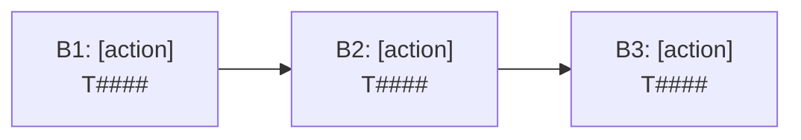

## 1. Case Information *(Step 2: Open the case)*

| Field | Value |
|---|---|
| Case ID | [e.g. CASE-002] |
| Incident name | [Victim + year, e.g. "MGM Resorts 2023"] |
| Analyst | [Your name / GitHub handle] |
| Date opened | [YYYY-MM-DD] |
| Date closed | [YYYY-MM-DD] |
| Status | [Open / In progress / Closed] |
| ATT&CK version used | [e.g. Enterprise v20. Check https://attack.mitre.org/resources/versions/] |
| Case type | Retrospective analysis of a public incident (open-source only) |
| Classification | TLP:CLEAR (public sources only) |

---

## 2. Executive Summary *(Step 8: write this LAST)*

*Write 4–6 sentences for a non-technical manager. Cover what happened, how the attacker got in, the most important weakness, the impact, and the single most important lesson.*

[Summary]

---

## 3. Incident Overview *(Step 2)*

| Field | Value |
|---|---|
| Victim organisation | [Name, industry, country] |
| Date(s) of incident | [Start – end, with time zone if known] |
| Date disclosed | [When the public found out] |
| Threat actor | [Name / group, or "Unknown"] |
| Attribution confidence | [High / Medium / Low, and who attributed it] |
| Motivation | [Financial, notoriety, espionage, unknown...] |
| Initial access vector (one line) | [e.g. "Phishing email with malicious attachment"] |
| Impact (one line) | [e.g. "Internal tools compromised; data downloaded"] |

**Scope statement:** *What this analysis covers and what it doesn't. Example: "This analysis covers the intrusion from initial access to containment. It does not cover the earlier malware infection of the contractor's personal device, which was done by an unknown party."*

[Scope statement]

---

## 4. Sources *(Step 1: Collect sources)*

**Source types:**
- **Primary:** the victim, a court, a regulator or a government body (Uber's own statement, an SEC filing, a CISA advisory).
- **Secondary:** journalists or security vendors reporting on the incident.
- **Claim:** a statement from the attacker. Useful, but never fully trusted.

**Reliability:** High / Medium / Low. Ask: would this source know, and does it have a reason to exaggerate?

| ID | Title | Publisher | Date | Type | Reliability | Link |
|---|---|---|---|---|---|---|
| S1 | Department of Justice Seizes $2.3 Million in Cryptocurrency Paid to the Ransomware Extortionists Darkside | US Department of Justice | 7 June 2021 | Primary | High | https://www.justice.gov/archives/opa/pr/department-justice-seizes-23-million-cryptocurrency-paid-ransomware-extortionists-darkside |
| S2 | Darkside Ransomware: Best Practices for Preventing Business Disruption from Ransomware Attacks | CISA & FBI | 11 May 2021 | Primary | High | https://www.cisa.gov/sites/default/files/publications/AA21-131A_Darkside_Ransomware.pdf |
| S3 | Hackers breached Colonial Pipeline with one compromised password | Aljazeera:Bloomberg | 4 June 2021 | Secondary | High | https://www.aljazeera.com/economy/2021/6/4/hackers-breached-colonial-pipeline-with-one-compromised-password |
| S4 | Colonial Pipeline CEO defends handling of ransomware attack in Senate testimony | CBSnews | 8 June 2021 | Secondary | High | https://www.cbsnews.com/news/colonial-pipeline-ceo-ransomware-hackers-senate-hearing/ |
| S5 | Shining a Light on DARKSIDE Ransomware Operations | Mandiant | 11 May 2021 | Secondary | High | https://cloud.google.com/blog/topics/threat-intelligence/shining-a-light-on-darkside-ransomware-operations |
| S6 | Colonial Pipeline Paid Hackers Nearly $5 Million in Ransom | Claims Journal:Bloomberg | 14 May 2021 | Secondary | High | https://www.claimsjournal.com/news/national/2021/05/14/303742.htm |
| S7 | THREATS TO CRITICAL INFRASTRUCTURE:EXAMINING THE COLONIAL PIPELINE CYBERATTACK (S. Hrg. 117-429) | US Government Publishing Office | 8 June 2021 | Primary | High | https://www.govinfo.gov/content/pkg/CHRG-117shrg46569/html/CHRG-117shrg46569.htm |

---

## 5. Timeline of Events *(Step 3: Build the timeline)*

*Write **facts only**, in chronological order. No ATT&CK IDs yet. Every row needs a source. If the time is unknown, write "Unknown – after E3" or similar.*

| Event | Date / time | What happened (fact) | Source(s) | Confirmed or claimed? |
|---|---|---|---|---|
| E1 | | | S1 | Confirmed |
| E2 | | | S3 | Claimed by attacker |

---

## 6. Behaviour Extraction *(Step 4: Break events into behaviours)*

*Rewrite each event as **one attacker action** in the form "Attacker [verb] [object] [how/where]". One event can produce several behaviours. Victim actions (e.g. "Uber rotated keys") are **not** behaviours. They go in Section 12.*

| Behaviour | From event | Attacker action | Evidence (paraphrase + source) |
|---|---|---|---|
| B1 | E1 | Attacker [verb] [object] | [S1 says...] |

---

## 7. ATT&CK Mapping *(Step 5: Map behaviours to ATT&CK)*

*For each behaviour, ask three questions in order:*
1. **Why** was the attacker doing this? That gives you the **Tactic**.
2. **How** did they do it? That gives you the **Technique**.
3. **Is there a more specific version** that matches the evidence? That gives you the **Sub-technique**. Only use it if the evidence supports it; otherwise stay at the parent technique.

**Confidence levels:**
- **High:** a primary source confirms the behaviour, and it clearly matches the technique definition.
- **Medium:** only secondary sources or attacker claims support it, or the technique fit is reasonable but not perfect.
- **Low:** a single unverified source, or an inference. Keep it in the table but say so.

| Behaviour | Tactic | Technique ID | Technique / sub-technique name | Why this technique (justification) | Confidence | Source(s) |
|---|---|---|---|---|---|---|
| B1 | | T#### | | | | |

### 7.1 Considered but not mapped

*Showing what you rejected and why is one of the strongest signals of analyst maturity.*

| Candidate technique | Why it was considered | Why it was rejected |
|---|---|---|
| T#### | | |

---

## 8. Attack Flow *(Step 6: Visualise)*

*A simple diagram of the attack in order. GitHub renders Mermaid diagrams automatically.*

---

## 9. ATT&CK Navigator Layer *(Step 6)*

- Layer file: [`navigator-layer.json`](./navigator-layer.json)
- To view it, open https://mitre-attack.github.io/attack-navigator/, choose **Open Existing Layer → Upload from local**, and select the file.
- Screenshot:

**Colour key:** [e.g. red = high confidence, orange = medium, yellow = low]

---

## 10. Detection Opportunities *(Step 7: Defensive analysis)*

*For each important technique: which log would show it, what you would look for, and an example of the logic. Use the "Detection" section of each technique page on attack.mitre.org.*

| Technique | Log source / data component | What to look for | Example detection logic (pseudo-query) |
|---|---|---|---|
| T#### | | | |

---

## 11. Mitigations & Recommendations *(Step 7)*

*Use the "Mitigations" section (M#### IDs) on each technique page. Then write a concrete recommendation in your own words.*

| Technique | Mitigation ID | Recommendation | Priority |
|---|---|---|---|
| T#### | M#### | | High / Medium / Low |

---

## 12. Victim Response *(Step 3/7)*

*What the victim did to contain, eradicate and recover. These are not attacker behaviours, so they don't get ATT&CK IDs.*

- [Action] (S#)

---

## 13. Analyst Notes & Lessons Learned *(Step 8)*

**Key lessons (for defenders):**
1. 

**Intelligence gaps / open questions:** *What couldn't you confirm? Where do sources disagree?*
- 

**What I learned doing this analysis:** *Employers read this section. Be honest and specific.*
- 

---

## 14. Change Log

| Date | Change |
|---|---|
| [YYYY-MM-DD] | Case opened |

